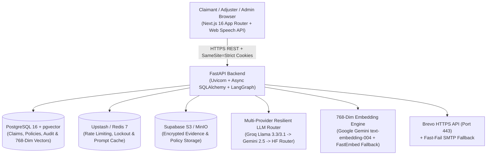

# IntelliClaim: Voice-Driven Agentic AI Insurance Claim Intake & Adjudication Platform

IntelliClaim is a production-grade, multi-tenant insurance claim intake, RAG-grounded conversational assistant, automated document verification, and adjuster adjudication platform aligned with **Indian IRDAI regulations** across six insurance lines (**Motor, Health, Senior Citizen Health, Home, Travel, and Cyber**).

Built with **FastAPI**, **LangGraph**, **Next.js 16 (React 19 + TypeScript)**, **PostgreSQL + `pgvector`**, **Redis**, **S3-Compatible Object Storage**, and a **Multi-Provider Resilient LLM Router** (**Groq + Google Gemini + Hugging Face**).

## Core Business Capabilities

### 1. Authentication & Account Security
- **Zero-Trust Session Lifecycle**: Short-lived in-memory JWT access tokens paired with `HttpOnly`, `SameSite=Strict`, path-scoped (`/api/v1/auth`) refresh cookies, token rotation, and reuse detection.
- **Account Recovery & Verification**: Enumeration-safe 6-digit SHA-256 OTP email verification and password reset flows delivered in `< 200ms` over HTTPS Port 443 (**Brevo HTTP API**) with SMTP fallback.
- **Brute-Force & Rate-Limit Protection**: Redis-pipelined sliding-window rate limiting and account lockout with automatic in-memory fallback (`InMemorySlidingWindowRateLimiter`).

### 2. Claimant Portal (`/claimant/*`)
- **Voice & Text Agentic AI Chatbot (`/claimant/file-claim`)**:
  - **Voice-Driven Conversational Intake**: Real-time client-side voice dictation via Browser Web Speech API (`SpeechRecognition`) + optional server-side Whisper/Pipecat WebRTC transport.
  - **100% Source-of-Truth RAG Grounding**: Answers policy coverage, new policy application (**Section 5**), and claim filing (**Section 6**) questions strictly from published Policy Wordings and IRDAI Regulatory Guidelines.
  - **Dynamic Requirement & Evidence Collection**: Extracts loss facts turn-by-turn, resolves conditional document requirements from compiled `.docx` manifests, and updates the **Live Claim Dossier** with an **Intake Readiness %** progress bar.
  - **Two-Step Cryptographic Confirmation & Auto-Assignment**: Records a SHA-256 submission confirmation (`POST /api/v1/claims/{ticket_id}/confirm`) and automatically assigns the filed claim to the least-loaded active adjuster matching the policy specialization.
- **Chat History Management (`/claimant/dashboard`)**: Review past conversational sessions, inspect turn counts and last message previews, resume draft sessions, rename or delete drafts, and export full JSON transcripts.
- **Multi-Factor Policy Linking (`/claimant/policies`)**: Link existing insurance policies to a claimant account by verifying Policy Number, Date of Birth, and Phone Last 4 digits (with 5-attempt lockout auditing).
- **Real-Time Claim Tracking & Adjuster Inquiries (`/claimant/claims/[ticketId]`)**: 5-stage visual lifecycle stepper (`Submitted` → `Policy Verified` → `Adjuster Assigned` → `In Review` → `Decision`) and direct document/note upload in response to adjuster information requests.

### 3. Adjuster Workspace (`/adjuster/*`)
- **Real-Time Adjuster Dashboard & Queue (`/adjuster/dashboard`, `/adjuster/queue`)**: Live KPIs (Total Claims in Pool, Assigned to Me, Pending Review, SLA Compliance, Fraud Alerts) and filterable adjudication queues.
- **5-Tab Claim Adjudication Workspace (`/adjuster/claims/[ticketId]`)**: Inspect extracted claim facts, confidence scores, verified evidence documents (with presigned preview/download), exceptions, and internal case notes, and record final decisions (`Approve`, `Partial Approve`, `Reject`, `Escalate`, or `Request Info`).
- **4-Phase AI Copilot Assistance**:
  - **Phase 1 (Zero-Token Deterministic Pre-Check)**: Verifies policy active window, coverage cap, deductibles, and mandatory document checklist completeness in `0ms`.
  - **Phase 2 (Quantified Fraud Rubric & IRDAI SLA Audit)**: Computes an auditable `fraud_score` (`0.00–1.00`) and tracks statutory IRDAI timelines (24h surveyor allocation, 15d survey report, 7d/15d settlement decision, 1h/3h cashless health authorization, Bank Rate + 2% delayed interest).
  - **Phase 3 (RAG-Grounded Executive Synopsis)**: Generates a cited adjudication report and recommended payout (`₹`) with `state_version` caching and deterministic fallback.
  - **Phase 4 (Interactive Copilot Chat Drawer)**: Follow-up Q&A grounded in retrieved policy clauses and regulatory circulars.
- **Policy Directory Lookup (`/adjuster/policies`)**: Search and verify policyholder names, policy numbers, validity dates, deductibles, and coverage limits.
- **Live Knowledge Base Management (`/adjuster/knowledge`)**: Upload, version, replace, re-index, and publish Policy Wording (`policy_wording`) and Regulatory (`regulation` / `policy_regulatory`) `.docx`, `.pdf`, and `.txt` files. Includes an XML document-order `.docx` parser that preserves inline tables under section headings and automatically compiles deterministic requirement manifests.

### 4. Admin Portal (`/admin/*`)
- **Operational Analytics Dashboard (`/admin/claims`)**: System-wide metrics (Active Policies, Submitted Claims, Approved Settlement Volume in `₹`, Adjuster Workload Utilization), stage distribution charts, and manual claim reassignment.
- **Policy Management & Bulk Ingestion (`/admin/policies`)**: Add single policies or bulk-import policies via CSV/XLSX templates (`Policyholder Name`, `Phone`, `DOB`, `Coverage Amount`, `Effective Date`, `Expiry Date`, `Optional Email`) and export filtered policy reports.
- **Adjuster Management & Onboarding (`/admin/adjusters`)**: Onboard adjusters via direct creation or secure email invitation links (`/onboarding/adjuster?token=...`), assign insurance specializations (`motor`, `health`, `senior_health`, `home`, `travel`, `cyber`, or `all`), and export adjuster workload reports.
- **Immutable Security & Governance Audit Log (`/admin/audit`)**: Track authentication events, policy links, claim state transitions, and knowledge base publications.

## System Architecture



## Repository Structure

```text
insurance_claim_intake/
├── backend/
│   ├── alembic/                  # Database migrations
│   ├── src/
│   │   ├── agents/               # LangGraph FNOL state machine, RAG chat & Multi-Provider LLM Router
│   │   ├── api/                  # FastAPI routers (auth, claims, adjuster, admin, policies, knowledge)
│   │   ├── database/             # SQLAlchemy ORM models, session pool & claim workflow engine
│   │   ├── domain/               # Canonical claim context & readiness logic
│   │   ├── evidence/             # Document OCR, magic-byte validation & verification
│   │   ├── knowledge/            # XML .docx parser, chunker, 768-dim embeddings, retriever & manifest compiler
│   │   ├── services/             # AI governance, durable outbox worker & OpenTelemetry
│   │   ├── storage/              # S3-compatible object storage & presigned URLs
│   │   └── utils/                # Auth JWT/bcrypt, HTTPS email OTP, rate limiter & validators
│   ├── tests/                    # Pytest unit, security & integration test suite
│   ├── requirements.txt          # Python production dependencies
│   └── run_e2e_server.py         # Auto-seeding FastAPI launcher for Playwright E2E tests
├── database/
│   └── seed_demo.py              # Idempotent demo seeder (users, adjusters, policies, claims & RAG docs)
├── frontend/
│   ├── e2e/                      # Playwright full-stack E2E verification suite
│   ├── src/
│   │   ├── app/                  # Next.js 16 App Router pages (claimant, adjuster, admin, auth)
│   │   ├── components/ui/        # Design system components (AppShell, Table, Modal, BadgePill)
│   │   └── lib/                  # API client, AuthContext, polling hooks & TypeScript types
│   └── playwright.config.ts      # Automated dual-server Playwright runner
├── docs/                         # AI governance & disaster recovery documentation
├── infra/aws/                    # Terraform AWS ECS / RDS / S3 infrastructure definitions
└── docker-compose.yml            # Local multi-container stack (Postgres/pgvector, Redis, MinIO, Mailpit)
```

## Local Development Setup

### Prerequisites
- **Python**: `3.11.9` (or `3.11+`)
- **Node.js**: `20+` / `22+` & `npm`
- **PostgreSQL 16 + `pgvector`** and **Redis 7** (via Docker Compose or local install)

### Option A: Quick Start with Local Python & Node.js

1. **Configure Environment Files**:
   ```bash
   cp .env.example .env
   cp backend/.env.example backend/.env
   cp frontend/.env.example frontend/.env.local
   ```

2. **Install Backend Dependencies, Run Migrations & Seed Demo Data**:
   ```bash
   python -m venv venv
   # Windows:
   venv\Scripts\activate
   # macOS / Linux:
   source venv/bin/activate

   pip install --upgrade pip
   pip install -r backend/requirements.txt
   cd backend && alembic upgrade head && cd ..
   python database/seed_demo.py
   ```

3. **Start the FastAPI Backend (`http://localhost:8000`)**:
   ```bash
   cd backend
   uvicorn src.api.main:app --host 0.0.0.0 --port 8000 --reload
   ```

4. **Start the Next.js Frontend (`http://localhost:3000`)**:
   ```bash
   cd frontend
   npm install
   npm run dev
   ```

### Option B: Running with Docker Compose
```bash
docker compose --profile dev up -d --build
```
- **Frontend**: `http://localhost:3000`
- **Backend API & Swagger Docs**: `http://localhost:8000/docs`
- **Mailpit Email UI**: `http://localhost:8025`

## Seeded Demo Accounts (`database/seed_demo.py`)

Running `python database/seed_demo.py` provisions deterministic demo accounts (default password: `DemoPass123!` unless `DEMO_PASSWORD` is set in the environment):

| Role | Email | Default Password | Pre-Seeded Context |
| :--- | :--- | :--- | :--- |
| **Claimant** | `riya.claimant@insurance.com` | `DemoPass123!` | Linked policy `POL-DEMO-MOTOR-001` & active claim `CLM-DEMO-MOTOR-001` |
| **Adjuster (Motor)** | `asha.adjuster@insurance.com` | `DemoPass123!` | Specialization: `motor` (Assigned `CLM-DEMO-MOTOR-001`) |
| **Adjuster (Health)** | `vikram.adjuster@insurance.com` | `DemoPass123!` | Specialization: `health` |
| **Adjuster (Senior Health)** | `meera.adjuster@insurance.com` | `DemoPass123!` | Specialization: `senior_health` |
| **Admin** | `admin@insurance.com` | `DemoPass123!` | Full tenant operational metrics, policy CRUD & adjuster management |

## Test & Verification Suite

### 1. Backend Unit & Integration Tests (`pytest`)
```bash
cd backend
pytest -q
```

### 2. Database Migration & Drift Check (`alembic`)
```bash
cd backend
alembic upgrade head
alembic check
```

### 3. Frontend Type Check, Lint & Unit Tests (`vitest`)
```bash
cd frontend
npm run lint
npx tsc --noEmit
npm test
npm run build
```

### 4. Full-Stack End-to-End Verification (`Playwright`)
Automatically seeds demo data, launches the FastAPI backend (`:8000`) and Next.js frontend (`:3000`), and verifies all 4 core business workflows (Authentication/OTP, Claimant RAG Chatbot & Policy Linking, Adjuster Workspace & AI Copilot, and Admin Portal):
```bash
cd frontend
npm run test:e2e
```

## Production Cloud Deployment (Render + Vercel + Supabase + Upstash + Brevo)

### 1. Render Web Service Configuration (Backend)
- **Root Directory**: `backend`
- **Runtime**: `Python 3` (`PYTHON_VERSION=3.11.9`)
- **Build Command** *(runs Alembic migrations at build time so container startup is fast)*:
  ```bash
  pip install --upgrade pip && pip install --no-cache-dir -r requirements.txt && alembic upgrade head
  ```
- **Start Command** *(uses built-in asyncio event loop compatible with `backend/requirements.txt`)*:
  ```bash
  uvicorn src.api.main:app --host 0.0.0.0 --port $PORT --workers 1 --no-access-log
  ```
- **24/7 Keep-Warm Health Endpoint**: Configure a free cron monitor (e.g., `cron-job.org`) to ping `GET https://<your-render-service>.onrender.com/api/v1/health/live` every 5 minutes.

### 2. Vercel Configuration (Frontend)
- **Root Directory**: `frontend`
- **Framework Preset**: `Next.js`
- **Environment Variable**:
  ```ini
  NEXT_PUBLIC_API_URL=https://<your-render-service>.onrender.com
  ```

### 3. Production Backend Environment Variables (`render-production.env`)

| Variable | Production Value / Format | Purpose |
| :--- | :--- | :--- |
| `PYTHON_VERSION` | `3.11.9` | Pins Python runtime on Render. |
| `ENVIRONMENT` | `production` | Enables strict production security guardrails. |
| `DEBUG` | `false` | Disables debug stack traces in API responses. |
| `SECRET_KEY` | `<64-char-hex-string>` | JWT signing secret (`python -c "import secrets; print(secrets.token_hex(32))"`). |
| `BCRYPT_ROUNDS` | `10` | OWASP-compliant cost factor tuned for `< 70ms` hashing on shared vCPUs. |
| `VERIFY_MIGRATIONS_ON_STARTUP` | `false` | Skips redundant runtime Alembic directory scan (migrations run in Build Command). |
| `REQUIRE_MIGRATIONS_IN_PRODUCTION` | `false` | Prevents startup block when migrations are handled during build. |
| `RUN_EMBEDDED_OUTBOX_WORKER` | `true` | Runs the non-blocking background outbox worker inside the web process. |
| `OUTBOX_POLL_INTERVAL_SECONDS` | `15` | Poll interval for durable outbox events. |
| `REQUIRE_REDIS_IN_PRODUCTION` | `true` | Enforces Redis configuration check on startup. |
| `SECURITY_FAIL_CLOSED` | `false` | Allows graceful fallback to in-memory rate limiting if Upstash Redis has a transient blip. |
| `REQUIRE_S3_IN_PRODUCTION` | `true` | Enforces S3-compatible object storage for claim evidence. |
| `REQUIRE_MALWARE_SCAN` | `false` | Disables external ClamAV daemon requirement on free cloud tiers (magic-byte checks stay active). |
| `REQUIRE_EMAIL_VERIFICATION` | `true` | Requires 6-digit OTP verification for new claimant sign-ups. |
| `VOICE_ENABLED` | `false` | Disables heavy server-side Pipecat/Whisper WebRTC daemon on 512 MB containers; claimant voice dictation runs client-side via Browser Web Speech API. |
| `NLTK_DATA` | `/tmp/nltk_data` | Directs NLTK to a private writable container directory. |
| `PUBLIC_APP_URL` | `https://<your-app>.vercel.app` | Canonical HTTPS frontend URL (no trailing slash). |
| `ALLOWED_ORIGINS` | `https://<your-app>.vercel.app` | Permitted CORS origin(s) (comma-separated, no trailing slash). |
| `DATABASE_URL` | `postgresql://postgres.<ref>:<pass>@aws-0-<region>.pooler.supabase.com:5432/postgres` | Supabase PostgreSQL Session Pooler URI (Port `5432` with `pgvector` enabled). |
| `DB_POOL_SIZE` / `DB_MAX_OVERFLOW` | `10` / `10` | SQLAlchemy connection pool sizing. |
| `REDIS_URL` | `rediss://default:<pass>@<endpoint>.upstash.io:6379` | Upstash Serverless Redis TLS URI (must start with `rediss://`). |
| `S3_BUCKET` | `intelliclaim-evidence` | Private bucket name in Supabase S3 Storage. |
| `S3_ENDPOINT_URL` | `https://<project-ref>.supabase.co/storage/v1/s3` | Supabase S3-compatible storage endpoint. |
| `AWS_REGION` | `ap-south-1` | Storage region identifier. |
| `AWS_ACCESS_KEY_ID` / `AWS_SECRET_ACCESS_KEY` | `<supabase-s3-keys>` | S3 credentials generated in Supabase Project Settings → Storage. |
| `BREVO_API_KEY` | `xkeysib-...` | Delivers OTP and notification emails in `< 200ms` over HTTPS Port 443 (bypasses blocked cloud SMTP Port 587). |
| `EMAIL_BACKEND` | `smtp` | Satisfies `validate_startup()` email configuration check alongside `SMTP_*` variables. |
| `SMTP_HOST` / `SMTP_PORT` | `smtp.gmail.com` / `587` | Fallback SMTP host and port. |
| `SMTP_USERNAME` / `SMTP_FROM_EMAIL` | `your-verified-sender@gmail.com` | Verified sender email address. |
| `SMTP_PASSWORD` | `<16-char-app-password>` | Gmail App Password for local/fallback SMTP. |
| `SMTP_FROM_NAME` | `IntelliClaim AI` | Display name on outbound transactional emails. |
| `SMTP_USE_TLS` / `SMTP_USE_SSL` | `true` / `false` | Transport encryption flags for SMTP. |
| `SMTP_TIMEOUT_SECONDS` | `4` | Fast-fail timeout for SMTP fallback. |
| `LLM_PROVIDER` | `groq` | Primary LLM provider (`groq`, `gemini`, or `huggingface`). |
| `FAST_LLM_PROVIDER` / `FAST_LLM_MODEL` | `groq` / `llama-3.1-8b-instant` | High-speed extraction and classification model. |
| `REASONING_LLM_PROVIDER` / `REASONING_LLM_MODEL` | `groq` / `llama-3.3-70b-versatile` | Deep reasoning model for RAG Q&A and Adjuster AI Copilot. |
| `GROQ_API_KEY` | `gsk_key1,gsk_key2` | Comma-separated Groq API keys for round-robin rotation. |
| `GEMINI_API_KEY` | `AIzaSy_key1,AIzaSy_key2` | Comma-separated Google AI Studio keys for LLM failover and 768-dim RAG embeddings. |
| `GEMINI_MODEL` / `GEMINI_FAST_MODEL` | `gemini-2.5-flash` / `gemini-2.5-flash-lite` | Google Gemini failover models. |
| `HF_TOKEN` | `hf_...` | Hugging Face Router token for tertiary LLM failover. |
| `AI_ALLOW_LOCAL_FALLBACK` | `false` | Prevents cloud containers from attempting localhost Ollama connections. |
| `AI_REQUIRE_MODEL_GOVERNANCE_IN_PRODUCTION` | `true` | Enforces `AI_ALLOWED_MODELS` allowlist in production. |
| `AI_ALLOWED_MODELS` | `openai/gpt-oss-20b:groq,openai/gpt-oss-20b,openai/gpt-oss-120b:groq,openai/gpt-oss-120b,llama-3.3-70b-versatile,llama-3.1-8b-instant,gemini-2.5-flash,gemini-2.5-flash-lite,Qwen/Qwen2.5-72B-Instruct,Qwen/Qwen2.5-7B-Instruct,meta-llama/Llama-3.3-70B-Instruct,Qwen/Qwen2.5-72B-Instruct:together` | Approved model IDs across Groq, Gemini, and Hugging Face Router. |
| `EMBEDDING_PROVIDER` | `gemini` | Uses Google's 768-dim Embedding API (`0 MB` container RAM overhead) with automatic local ONNX `FastEmbed` (`BAAI/bge-base-en-v1.5`) fallback. |
| `EMBEDDING_MODEL` / `EMBEDDING_DIMENSION` | `text-embedding-004` / `768` | 768-dimension vector configuration matching PostgreSQL `vector(768)`. |

## Ingesting the 12 Authoritative IRDAI RAG Documents (`docrag/*.docx`)

1. Sign in to the live portal as an **Adjuster** (`asha.adjuster@insurance.com`) or **Admin** (`admin@insurance.com`).
2. Navigate to **Knowledge Base Management (`/adjuster/knowledge`)**.
3. Upload the 12 `.docx` files from `docrag/` (6 **Policy Wordings** + 6 **Regulatory & Claims Guides** across `motor`, `health`, `senior_health`, `home`, `travel`, and `cyber`) with Jurisdiction set to **`India`**.
4. Each uploaded document is automatically parsed in XML document order (preserving inline tables under Section 5 and Section 6 headings), chunked, embedded into 768-dimension vectors in Supabase PostgreSQL (`knowledge_chunks`), compiled into a deterministic `requirement_manifest`, and set to **`published`**.
